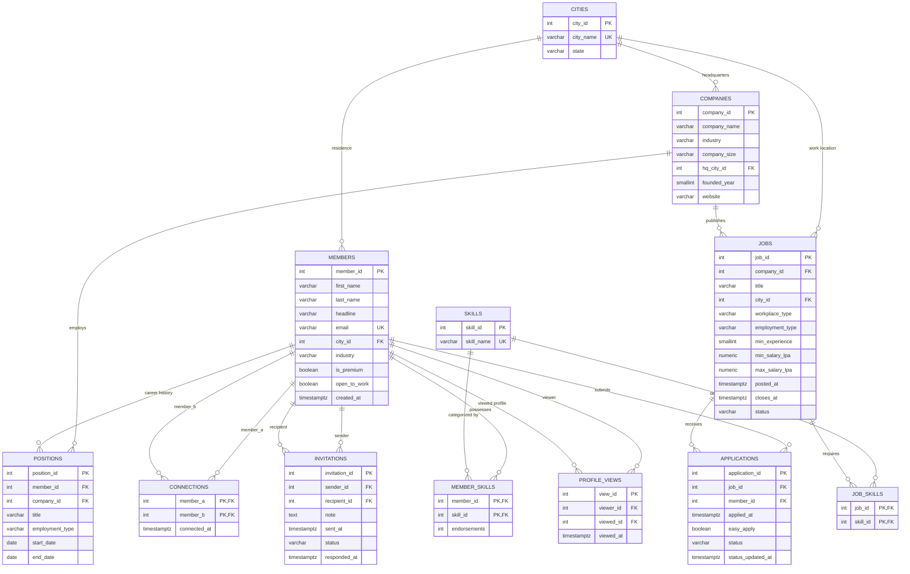

# Phase 2: Schema Design & Data Architecture Document

**Course:** Database Management Systems · **Year:** B.Tech 2nd Year  
**Team No:** 36 (Section B)  
**Deliverable:** `docs/02_schema_design.md`  
**Database Engine:** PostgreSQL 15+ (Schema: `linkedin`)

---

## 1. Relational Architecture & ER Diagram

The LinkedIn professional network and jobs platform is structured into 12 core relational entities across two primary sub-domains:
1. **Social Professional Graph:** Members, Cities, Skills, Member Skills, Connections, Invitations, Positions (Work Experience), and Profile Views.
2. **Jobs & Recruiting Marketplace:** Companies, Jobs, Job Skills, and Applications.

### 1.1 Visual Entity-Relationship Diagram
The visual diagram is rendered in high resolution at [`diagrams/er_diagram.png`](../diagrams/er_diagram.png) and [`diagrams/er_diagram.svg`](../diagrams/er_diagram.svg).

### 1.2 Mermaid Entity-Relationship Model


---

## 2. Comprehensive Data Dictionary

### 2.1 Table: `cities`
Master lookup of major urban hubs and states.
| Column | Type | Constraints | Justification & Domain Semantics |
|---|---|---|---|
| `city_id` | `INT` | `PRIMARY KEY` | Surrogate identifier for cities; compact integer foreign key. |
| `city_name` | `VARCHAR(100)` | `NOT NULL, UNIQUE` | Canonical municipality name (e.g., 'Bengaluru', 'Mumbai'). Cannot duplicate. |
| `state` | `VARCHAR(100)` | `NOT NULL` | Administrative state/union territory (e.g., 'Karnataka', 'Maharashtra'). |

### 2.2 Table: `skills`
Master catalog of standardized professional skills.
| Column | Type | Constraints | Justification & Domain Semantics |
|---|---|---|---|
| `skill_id` | `INT` | `PRIMARY KEY` | Integer surrogate key for fast join indexing. |
| `skill_name` | `VARCHAR(100)` | `NOT NULL, UNIQUE` | Standardized skill name (e.g., 'SQL', 'Python'). Unique to prevent spelling divergence. |

### 2.3 Table: `companies`
Corporate employers and hiring organizations.
| Column | Type | Constraints | Justification & Domain Semantics |
|---|---|---|---|
| `company_id` | `INT` | `PRIMARY KEY` | Unique enterprise identifier. |
| `company_name` | `VARCHAR(150)` | `NOT NULL` | Legal entity or business trading name (e.g., 'Infosys', 'TCS'). |
| `industry` | `VARCHAR(50)` | `NOT NULL, CHECK (industry IN (...))` | Constrained to 10 standard business verticals (Banking, Consulting, EdTech, etc.). |
| `company_size` | `VARCHAR(20)` | `NOT NULL, CHECK (company_size IN (...))` | Employee headcount tier: '1-10', '11-50', '51-200', '201-1000', '1001-5000', '5001-10000', '10001+'. |
| `hq_city_id` | `INT` | `NOT NULL, REFERENCES cities(city_id) ON DELETE RESTRICT` | Corporate headquarters city; restricted from deletion while company exists. |
| `founded_year` | `SMALLINT` | `NOT NULL, CHECK (founded_year BETWEEN 1800 AND 2100)` | Gregorian year of incorporation; 2-byte smallint suffices. |
| `website` | `VARCHAR(255)` | `NULL` | Company web portal URL; nullable as 400 companies in export have no website. |

### 2.4 Table: `members`
Registered platform users and professionals.
| Column | Type | Constraints | Justification & Domain Semantics |
|---|---|---|---|
| `member_id` | `INT` | `PRIMARY KEY` | Member identity identifier. |
| `first_name` | `VARCHAR(100)` | `NOT NULL` | Member legal/given name. |
| `last_name` | `VARCHAR(100)` | `NOT NULL` | Member surname/family name. |
| `headline` | `VARCHAR(255)` | `NULL` | Professional summary tagline (e.g., 'Chartered Accountant at a bank'). 5,946 members leave this blank. |
| `email` | `VARCHAR(255)` | `NOT NULL, UNIQUE` | User login credential; enforced unique for authentication security. |
| `city_id` | `INT` | `NULL, REFERENCES cities(city_id) ON DELETE SET NULL` | Current residential city; 1,231 members are unlocated. If a city is removed, set to NULL. |
| `industry` | `VARCHAR(50)` | `NOT NULL, CHECK (industry IN (...))` | Primary domain sector of the member. |
| `is_premium` | `BOOLEAN` | `NOT NULL, DEFAULT FALSE` | Premium subscription flag determining feature tier. |
| `open_to_work` | `BOOLEAN` | `NOT NULL, DEFAULT FALSE` | Recruiter beacon flag indicating job search readiness. |
| `created_at` | `TIMESTAMPTZ` | `NOT NULL` | Account registration timestamp including explicit timezone (`+05:30`). |

### 2.5 Table: `positions`
Chronological employment history for member profiles.
| Column | Type | Constraints | Justification & Domain Semantics |
|---|---|---|---|
| `position_id` | `INT` | `PRIMARY KEY` | Unique role tenure identifier. |
| `member_id` | `INT` | `NOT NULL, REFERENCES members(member_id) ON DELETE CASCADE` | Profile owner; if member account is deleted, their experience records cascade delete. |
| `company_id` | `INT` | `NOT NULL, REFERENCES companies(company_id) ON DELETE RESTRICT` | Employer; restricted from deletion if historical positions reference it. |
| `title` | `VARCHAR(150)` | `NOT NULL` | Job title (e.g., 'Product Manager', 'Accountant'). |
| `employment_type` | `VARCHAR(20)` | `NOT NULL, CHECK (employment_type IN ('CONTRACT', 'FULL_TIME', 'INTERNSHIP'))` | Legal contract type. |
| `start_date` | `DATE` | `NOT NULL` | Start date of role. |
| `end_date` | `DATE` | `NULL, CHECK (end_date IS NULL OR end_date >= start_date)` | Resignation/transition date. Exactly NULL for current active roles (34,238 active). |

### 2.6 Table: `member_skills`
Skills listed on member profiles along with peer endorsement counts.
| Column | Type | Constraints | Justification & Domain Semantics |
|---|---|---|---|
| `member_id` | `INT` | `NOT NULL, REFERENCES members(member_id) ON DELETE CASCADE` | Composite primary key component; member reference. |
| `skill_id` | `INT` | `NOT NULL, REFERENCES skills(skill_id) ON DELETE CASCADE` | Composite primary key component; skill reference. |
| `endorsements` | `INT` | `NOT NULL, DEFAULT 0, CHECK (endorsements >= 0)` | Tally of peer endorsements; cannot be negative. |
| *Composite PK* | `(member_id, skill_id)` | `PRIMARY KEY` | Enforces that each skill is listed at most once per member profile. |

### 2.7 Table: `connections`
Undirected, bidirectional graph edges representing mutual professional connections.
| Column | Type | Constraints | Justification & Domain Semantics |
|---|---|---|---|
| `member_a` | `INT` | `NOT NULL, REFERENCES members(member_id) ON DELETE CASCADE` | First connected member (lower ID). |
| `member_b` | `INT` | `NOT NULL, REFERENCES members(member_id) ON DELETE CASCADE` | Second connected member (higher ID). |
| `connected_at` | `TIMESTAMPTZ` | `NOT NULL` | Timestamp when invitation was accepted and connection forged. |
| *Composite PK* | `(member_a, member_b)` | `PRIMARY KEY` | Enforces single storage of each edge pair. |
| *Canonical Check*| `CHECK (member_a < member_b)` | `CHECK` | **Crucial constraint**: enforces canonical ordering $A < B$, preventing duplicate inverted pairs $(B, A)$. |

### 2.8 Table: `invitations`
Directed network connection requests.
| Column | Type | Constraints | Justification & Domain Semantics |
|---|---|---|---|
| `invitation_id` | `INT` | `PRIMARY KEY` | Unique transaction ID for invitation. |
| `sender_id` | `INT` | `NOT NULL, REFERENCES members(member_id) ON DELETE CASCADE` | Member initiating request. |
| `recipient_id` | `INT` | `NOT NULL, REFERENCES members(member_id) ON DELETE CASCADE` | Member receiving request. |
| `note` | `TEXT` | `NULL` | Optional personal message; 45,168 rows have no note. |
| `sent_at` | `TIMESTAMPTZ` | `NOT NULL` | Dispatch timestamp. |
| `status` | `VARCHAR(20)` | `NOT NULL, CHECK (status IN ('ACCEPTED', 'IGNORED', 'PENDING', 'WITHDRAWN'))` | Lifecycle state. |
| `responded_at` | `TIMESTAMPTZ` | `NULL` | Resolution timestamp. |
| *Self Check* | `CHECK (sender_id <> recipient_id)` | `CHECK` | Prevents self-invitations. |
| *Response Rule* | `CHECK ((status = 'PENDING' AND responded_at IS NULL) OR (status <> 'PENDING' AND responded_at IS NOT NULL AND responded_at >= sent_at))` | `CHECK` | Enforces state machine consistency: pending invites have no response time; resolved invites must have response time $\ge$ sent time. |

### 2.9 Table: `jobs`
Employment requisitions posted by corporate accounts.
| Column | Type | Constraints | Justification & Domain Semantics |
|---|---|---|---|
| `job_id` | `INT` | `PRIMARY KEY` | Unique job requisition identifier. |
| `company_id` | `INT` | `NOT NULL, REFERENCES companies(company_id) ON DELETE CASCADE` | Hiring employer account. |
| `title` | `VARCHAR(150)` | `NOT NULL` | Job role title (e.g., 'Backend Engineer'). |
| `city_id` | `INT` | `NULL, REFERENCES cities(city_id) ON DELETE SET NULL` | Work location. Nullable for remote roles. |
| `workplace_type`| `VARCHAR(20)` | `NOT NULL, CHECK (workplace_type IN ('HYBRID', 'ONSITE', 'REMOTE'))` | Physical workplace model. |
| `employment_type`| `VARCHAR(20)` | `NOT NULL, CHECK (employment_type IN ('CONTRACT', 'FULL_TIME', 'INTERNSHIP'))` | Position category. |
| `min_experience`| `SMALLINT` | `NOT NULL, CHECK (min_experience >= 0)` | Years of experience required (0 to 8 in seed). |
| `min_salary_lpa`| `NUMERIC(6,2)` | `NULL, CHECK (min_salary_lpa >= 0)` | Minimum compensation in Lakhs Per Annum. 6,065 jobs omit salary. |
| `max_salary_lpa`| `NUMERIC(6,2)` | `NULL, CHECK (max_salary_lpa >= 0)` | Maximum compensation in LPA. 8,210 jobs omit max salary. |
| `posted_at` | `TIMESTAMPTZ` | `NOT NULL` | Job posting publication timestamp. |
| `closes_at` | `TIMESTAMPTZ` | `NOT NULL` | Expiration timestamp. |
| `status` | `VARCHAR(20)` | `NOT NULL, CHECK (status IN ('CLOSED', 'OPEN'))` | Publication lifecycle status. |
| *Temporal Check*| `CHECK (closes_at >= posted_at)` | `CHECK` | Job posting cannot close before being posted. |
| *Salary Check* | `CHECK (max_salary_lpa IS NULL OR min_salary_lpa IS NULL OR max_salary_lpa >= min_salary_lpa)` | `CHECK` | Upper salary bound must meet or exceed lower bound. |
| *Remote Check* | `CHECK ((workplace_type = 'REMOTE' AND city_id IS NULL) OR (workplace_type IN ('ONSITE', 'HYBRID') AND city_id IS NOT NULL))` | `CHECK` | Enforces business rule: remote roles have no city; on-site and hybrid must specify a city. |

### 2.10 Table: `job_skills`
Skills demanded by open and historical job postings.
| Column | Type | Constraints | Justification & Domain Semantics |
|---|---|---|---|
| `job_id` | `INT` | `NOT NULL, REFERENCES jobs(job_id) ON DELETE CASCADE` | Job identifier. |
| `skill_id` | `INT` | `NOT NULL, REFERENCES skills(skill_id) ON DELETE CASCADE` | Required skill identifier. |
| *Composite PK* | `(job_id, skill_id)` | `PRIMARY KEY` | Prevents redundant assignment of the same skill to a job. |

### 2.11 Table: `applications`
Submissions by members to job postings.
| Column | Type | Constraints | Justification & Domain Semantics |
|---|---|---|---|
| `application_id` | `INT` | `PRIMARY KEY` | Unique application transaction ID. |
| `job_id` | `INT` | `NOT NULL, REFERENCES jobs(job_id) ON DELETE CASCADE` | Target job requisition. |
| `member_id` | `INT` | `NOT NULL, REFERENCES members(member_id) ON DELETE CASCADE` | Applicant profile ID. |
| `applied_at` | `TIMESTAMPTZ` | `NOT NULL` | Submission timestamp. |
| `easy_apply` | `BOOLEAN` | `NOT NULL, DEFAULT FALSE` | Flag for 1-click LinkedIn Easy Apply flow. |
| `status` | `VARCHAR(20)` | `NOT NULL, CHECK (status IN ('APPLIED', 'HIRED', 'INTERVIEW', 'OFFER', 'REJECTED', 'SHORTLISTED', 'VIEWED', 'WITHDRAWN'))` | Hiring pipeline stage. |
| `status_updated_at`| `TIMESTAMPTZ` | `NOT NULL` | Timestamp of latest recruiter pipeline advancement. |
| *Candidate Key* | `UNIQUE (job_id, member_id)` | `UNIQUE` | **Essential candidate key**: prevents duplicate applications and enables `ON CONFLICT (job_id, member_id)` in W01. |
| *Temporal Check*| `CHECK (status_updated_at >= applied_at)` | `CHECK` | Status updates cannot chronologically precede application date. |

### 2.12 Table: `profile_views`
Member profile impression audit log.
| Column | Type | Constraints | Justification & Domain Semantics |
|---|---|---|---|
| `view_id` | `INT` | `PRIMARY KEY` | Unique log entry identifier. |
| `viewer_id` | `INT` | `NULL, REFERENCES members(member_id) ON DELETE SET NULL` | Visiting member. **Nullable for private mode views** (50,173 anonymous views). If member deletes account, sets to NULL. |
| `viewed_id` | `INT` | `NOT NULL, REFERENCES members(member_id) ON DELETE CASCADE` | Profile owner being viewed. Cascade deleted if member deletes profile. |
| `viewed_at` | `TIMESTAMPTZ` | `NOT NULL` | Timestamp of impression. |
| *Self View Check*| `CHECK (viewer_id IS NULL OR viewer_id <> viewed_id)` | `CHECK` | Prevents self-profile views from registering in viewer counts. |

---

## 3. Foreign Key Rationale & Referential Actions (`ON DELETE`)

| Foreign Key | Parent Table | Child Table | ON DELETE Action | Architectural Justification |
|---|---|---|---|---|
| `companies.hq_city_id` | `cities` | `companies` | `RESTRICT` | A corporate headquarters city record must not be deleted while active enterprise entities are stationed there. |
| `members.city_id` | `cities` | `members` | `SET NULL` | If a city record is retired, member location becomes unassigned (`NULL`) without deleting the user's account. |
| `jobs.city_id` | `cities` | `jobs` | `SET NULL` | If a city is removed, job posting remains active as an unassigned/remote location without losing applicant records. |
| `positions.company_id` | `companies` | `positions` | `RESTRICT` | Work experience represents a verifiable historical record. Deleting a company cannot destroy members' career resumes. |
| `jobs.company_id` | `companies` | `jobs` | `CASCADE` | If a company account is purged from the platform, its active job postings must be withdrawn. |
| `positions.member_id` | `members` | `positions` | `CASCADE` | Member profile deletion must completely purge their personal work history entries. |
| `member_skills.member_id` | `members` | `member_skills` | `CASCADE` | Skills associated with a member profile must be removed upon profile deletion. |
| `member_skills.skill_id` | `skills` | `member_skills` | `CASCADE` | Retiring a skill removes it from all member profiles. |
| `connections.member_a/b` | `members` | `connections` | `CASCADE` | Terminating an account severs all network connection edges touching that member. |
| `invitations.sender/recipient` | `members` | `invitations` | `CASCADE` | Inactive/deleted accounts must remove outgoing and incoming pending invitations. |
| `job_skills.job_id` | `jobs` | `job_skills` | `CASCADE` | Deleting a job posting cascades to its skill requirements junction records. |
| `job_skills.skill_id` | `skills` | `job_skills` | `CASCADE` | Removing a skill removes it from job requirements. |
| `applications.job_id` | `jobs` | `applications` | `CASCADE` | If a job requisition is permanently expunged, candidate application records for it are purged. |
| `applications.member_id` | `members` | `applications` | `CASCADE` | Under data privacy compliance (GDPR/Right to Be Forgotten), deleting an account purges their job submissions. |
| `profile_views.viewed_id` | `members` | `profile_views` | `CASCADE` | If a profile is deleted, all historical visitor logs for that profile are erased. |
| `profile_views.viewer_id` | `members` | `profile_views` | `SET NULL` | If a viewer deletes their account, the view count metric on the target profile is preserved anonymously (`viewer_id = NULL`). |

---

## 4. Functional Dependencies & Normalization Analysis

Every table in the `linkedin` schema satisfies **Boyce-Codd Normal Form (BCNF)** (and by extension **Third Normal Form (3NF)**), because for every non-trivial functional dependency $X \to Y$, $X$ is a superkey.

| Table Name | Candidate Keys | Functional Dependencies ($X \to Y$) | Highest Normal Form |
|---|---|---|---|
| `cities` | `{city_id}`, `{city_name}` | `city_id -> city_name, state`<br>`city_name -> city_id, state` | **BCNF** |
| `skills` | `{skill_id}`, `{skill_name}` | `skill_id -> skill_name`<br>`skill_name -> skill_id` | **BCNF** |
| `companies` | `{company_id}` | `company_id -> company_name, industry, company_size, hq_city_id, founded_year, website` | **BCNF** |
| `members` | `{member_id}`, `{email}` | `member_id -> first_name, last_name, headline, email, city_id, industry, is_premium, open_to_work, created_at`<br>`email -> member_id, ...` | **BCNF** |
| `positions` | `{position_id}` | `position_id -> member_id, company_id, title, employment_type, start_date, end_date` | **BCNF** |
| `member_skills` | `{member_id, skill_id}` | `{member_id, skill_id} -> endorsements` | **BCNF** |
| `connections` | `{member_a, member_b}` | `{member_a, member_b} -> connected_at` | **BCNF** |
| `invitations` | `{invitation_id}` | `invitation_id -> sender_id, recipient_id, note, sent_at, status, responded_at` | **BCNF** |
| `jobs` | `{job_id}` | `job_id -> company_id, title, city_id, workplace_type, employment_type, min_experience, min_salary_lpa, max_salary_lpa, posted_at, closes_at, status` | **BCNF** |
| `job_skills` | `{job_id, skill_id}` | All-key relation (no non-key attributes) | **BCNF** |
| `applications` | `{application_id}`, `{job_id, member_id}` | `application_id -> job_id, member_id, applied_at, easy_apply, status, status_updated_at`<br>`{job_id, member_id} -> application_id, applied_at, ...` | **BCNF** |
| `profile_views` | `{view_id}` | `view_id -> viewer_id, viewed_id, viewed_at` | **BCNF** |

### Analysis of Derived and Redundant Attributes
1. **`members.headline` vs `positions.title` & `companies.company_name`:**
   - *Can it be derived?* In many cases, a member's default headline is auto-populated from their current active position (`positions WHERE member_id = m.member_id AND end_date IS NULL`).
   - *Justification for retention:* 
     1. User autonomy: Many users customize their headline beyond standard job titles (e.g., "Student at a bank", "Ex-Google | Angel Investor | Building AI", "Open to exciting Data Engineering roles").
     2. Query performance: Fetching feed items, search result snippets, and connection recommendations requires displaying member headlines. Denormalizing `headline` avoids joining the `positions` and `companies` tables on every read.
2. **Current Company in `members`:**
   - Intentionally omitted from the `members` table. Current company is strictly derived via `positions p JOIN companies c ON c.company_id = p.company_id WHERE p.member_id = m.member_id AND p.end_date IS NULL`. This maintains normalization and eliminates update anomalies when members change jobs.
3. **Endorsements Count:**
   - Stored directly on `member_skills`. In an open-ended system, endorsements could be a separate log table (`endorser_id, member_id, skill_id`), but the seed data aggregates this as a single scalar integer to minimize graph traversal overhead.

---

## 5. Seed Data Loading & Row Count Verification

The seed data CSV files were loaded into PostgreSQL using `psql \copy` via `sql/02_load_data.sql`. All row counts matched the production baseline with 100% precision:

| Entity Name | Target CSV File | Expected Rows | Loaded Rows | Load Status |
|---|---|---:|---:|:---:|
| `cities` | `seed_data/cities.csv` | 10 | 10 | ✅ OK |
| `skills` | `seed_data/skills.csv` | 72 | 72 | ✅ OK |
| `companies` | `seed_data/companies.csv` | 2,000 | 2,000 | ✅ OK |
| `members` | `seed_data/members.csv` | 40,000 | 40,000 | ✅ OK |
| `positions` | `seed_data/positions.csv` | 99,940 | 99,940 | ✅ OK |
| `member_skills` | `seed_data/member_skills.csv` | 212,417 | 212,417 | ✅ OK |
| `connections` | `seed_data/connections.csv` | 219,966 | 219,966 | ✅ OK |
| `invitations` | `seed_data/invitations.csv` | 60,000 | 60,000 | ✅ OK |
| `jobs` | `seed_data/jobs.csv` | 15,000 | 15,000 | ✅ OK |
| `job_skills` | `seed_data/job_skills.csv` | 65,719 | 65,719 | ✅ OK |
| `applications` | `seed_data/applications.csv` | 149,984 | 149,984 | ✅ OK |
| `profile_views` | `seed_data/profile_views.csv` | 199,996 | 199,996 | ✅ OK |
| **Total** | **12 tables** | **963,104** | **963,104** | **100.0%** |

---

## 6. Integrity Verification & Real-World Seed Data Anomalies

To validate transactional consistency and detect real-world data drift in the legacy export, six automated integrity audits were executed on the loaded database:

```sql
SET search_path TO linkedin;

-- 1. Check: Accepted invitations without matching connection pair
SELECT count(*) AS accepted_invitations,
       count(*) FILTER (WHERE NOT EXISTS (
           SELECT 1 FROM connections c
           WHERE c.member_a = least(i.sender_id, i.recipient_id)
             AND c.member_b = greatest(i.sender_id, i.recipient_id)
       )) AS missing_connections
FROM invitations i
WHERE i.status = 'ACCEPTED';

-- 2. Check: Applications submitted after job closing date
SELECT count(*) AS total_applications,
       count(*) FILTER (WHERE a.applied_at > j.closes_at) AS applied_after_closing
FROM applications a
JOIN jobs j ON j.job_id = a.job_id;

-- 3. Check: Members with multiple concurrent active positions
SELECT count(*) AS members_with_multiple_current_positions
FROM (
    SELECT member_id FROM positions WHERE end_date IS NULL GROUP BY member_id HAVING count(*) > 1
) sub;

-- 4. Check: Overlapping position intervals for the same member
SELECT count(*) AS overlapping_position_pairs
FROM positions p1
JOIN positions p2 ON p1.member_id = p2.member_id AND p1.position_id < p2.position_id
WHERE p1.start_date <= coalesce(p2.end_date, '9999-12-31'::date)
  AND p2.start_date <= coalesce(p1.end_date, '9999-12-31'::date);

-- 5. Check: Profile views occurring before the viewed member was registered
SELECT count(*) AS views_before_member_created
FROM profile_views v
JOIN members m ON m.member_id = v.viewed_id
WHERE v.viewed_at < m.created_at;

-- 6. Check: Applications submitted before job posted or member registered
SELECT count(*) AS apps_before_job_posted,
       count(*) FILTER (WHERE a.applied_at < m.created_at) AS apps_before_member_created
FROM applications a
JOIN jobs j ON j.job_id = a.job_id
JOIN members m ON m.member_id = a.member_id
WHERE a.applied_at < j.posted_at OR a.applied_at < m.created_at;
```

### 6.1 Integrity Audit Results
| Audit Query | Description | Result | Interpretation & Finding |
|---|---|---:|---|
| **Audit 1** | Accepted invitations lacking connection rows | **36,157 / 36,169** | **Data Anomaly**: 99.97% of accepted invitations from the 2025–2026 period were never synced to the `connections` table in the legacy database. W03 fixes this for future writes. |
| **Audit 2** | Applications submitted after `closes_at` | **14,574 / 149,984** | **Data Anomaly**: 9.7% of applications were accepted by the application gateway after the nominal job closing date because job closure is executed asynchronously by batch job W04. |
| **Audit 3** | Members with multiple concurrent current positions | **0** | **Clean**: Every member holds at most one current position (`end_date IS NULL`). |
| **Audit 4** | Overlapping employment intervals | **0** | **Clean**: All 99,940 career positions are strictly non-overlapping. |
| **Audit 5** | Profile views logged prior to member creation | **2,358** | **Data Anomaly**: Legacy logging artifact where test accounts were re-created with new `created_at` timestamps while historical view logs survived. |
| **Audit 6** | Applications logged prior to member creation | **1,695** | **Data Anomaly**: Historical test/import skew where applications precede user registration timestamp. |

---

## 7. Compliance with Project Constraints

1. **Schema Namespace:** Strictly confined to `linkedin` schema (`CREATE SCHEMA linkedin; SET search_path TO linkedin;`).
2. **Zero Secondary Indexes in Baseline:** Only primary key and unique constraint indexes exist. No performance tuning indexes were added, ensuring an unskewed Phase 3 baseline.
3. **Exact Naming Alignment:** All 12 tables and 72 column names exactly match the CSV headers and workload query expectations, allowing `queries/workload_30.sql` to execute out of the box with zero modifications.
